<div align="center">

# Лот

**Онлайн-аукцион искусства, антиквариата и предметов коллекционирования — со ставками в реальном времени**


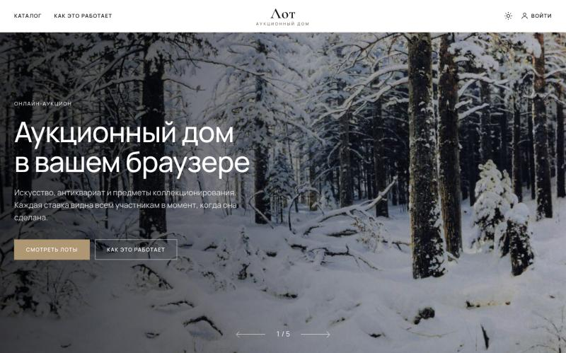

</div>

Продавец выставляет лот со стартовой ценой и шагом торгов, покупатели повышают ставки, а когда таймер
доходит до нуля — сервер сам закрывает торги и фиксирует победителя. Каждая ставка мгновенно появляется
у всех, кто смотрит лот: без перезагрузки страницы и без опроса сервера.

Проект сделан как учебный, но с упором на то, что обычно остаётся за кадром: **честную обработку
одновременных ставок**, проверенную тестами и нагрузкой на 1000 WebSocket-подключений.

---

## Содержание

- [Возможности](#возможности)
- [Скриншоты](#скриншоты)
- [Быстрый старт](#быстрый-старт)
- [Демо-аккаунты](#демо-аккаунты)
- [Как это устроено](#как-это-устроено)
- [API](#api)
- [Тестирование и нагрузка](#тестирование-и-нагрузка)
- [Настройка](#настройка)
- [Структура проекта](#структура-проекта)
- [Что можно улучшить](#что-можно-улучшить)
- [Изображения](#изображения)

---

## Возможности

**Покупателю**
- Каталог с фильтром по категориям, поиском, сортировкой и пагинацией — фильтры хранятся в URL.
- Страница лота: галерея (свайп, полноэкранный просмотр), описание, история ставок, счётчик «сейчас смотрят».
- Ставка с проверкой минимальной суммы, быстрыми суммами и **подтверждением вторым нажатием**.
- Таймер обратного отсчёта по **часам сервера** — не зависит от неточных часов пользователя.
- Уведомления на любой странице: «вашу ставку перебили», «вы выиграли».
- «Мои торги»: где лидирую, где перебили, что выиграл.

**Продавцу**
- Выставление лота: фото (до 10), описание, стартовая цена, шаг торгов, длительность от 5 минут до 7 дней.
- Каждая ставка по своим лотам — в реальном времени; уведомление о продаже.

**Администратору**
- Статистика площадки и живая лента всех ставок.
- Снятие лота с торгов с указанием причины — ставки останавливаются мгновенно.
- Блокировка пользователей (с возможностью сразу снять их лоты); действует без ожидания истечения сессии.

**Для всех**
- Светлая и тёмная тема (по умолчанию — как в системе, выбор запоминается).
- Адаптивная вёрстка: на телефоне — нижняя навигация, лента категорий, закреплённая панель ставки.
- Дизайн в стилистике музейного сайта: прямые углы, тонкие линии, бронзовый акцент, антиква для цен и дат.

---

## Скриншоты

| Главная: «Как это работает» | Главная: «Скоро завершатся» |
|---|---|
| 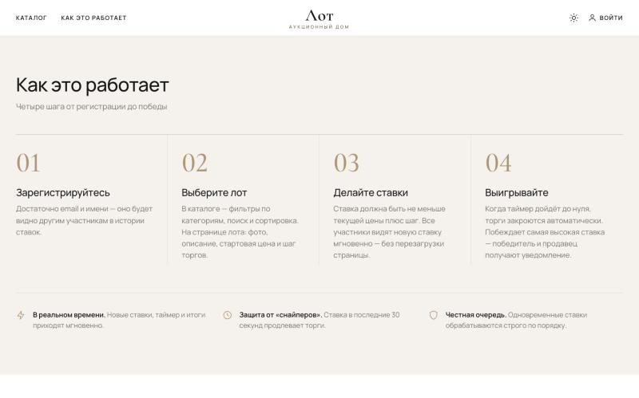 | 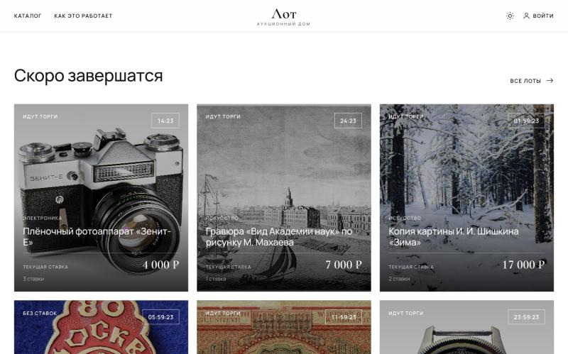 |

| Страница лота — светлая тема | Страница лота — тёмная тема |
|---|---|
| 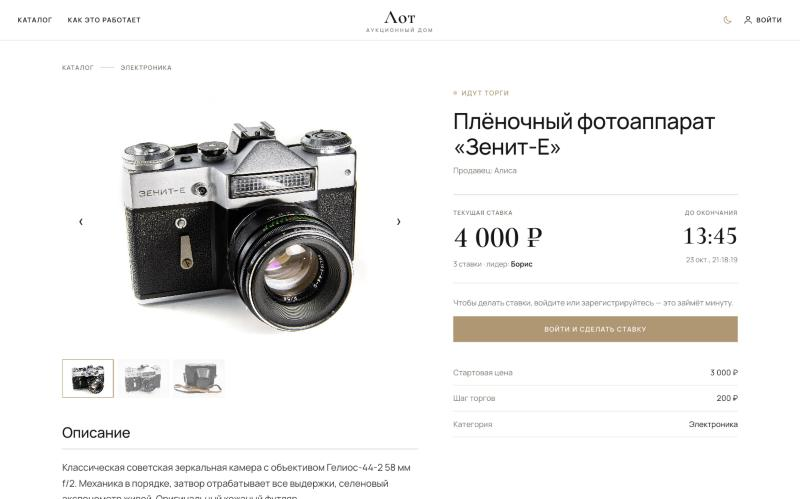 | 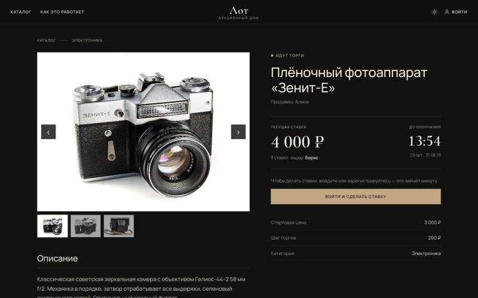 |

| Каталог | Вход и демо-аккаунты | Админ-панель |
|---|---|---|
| 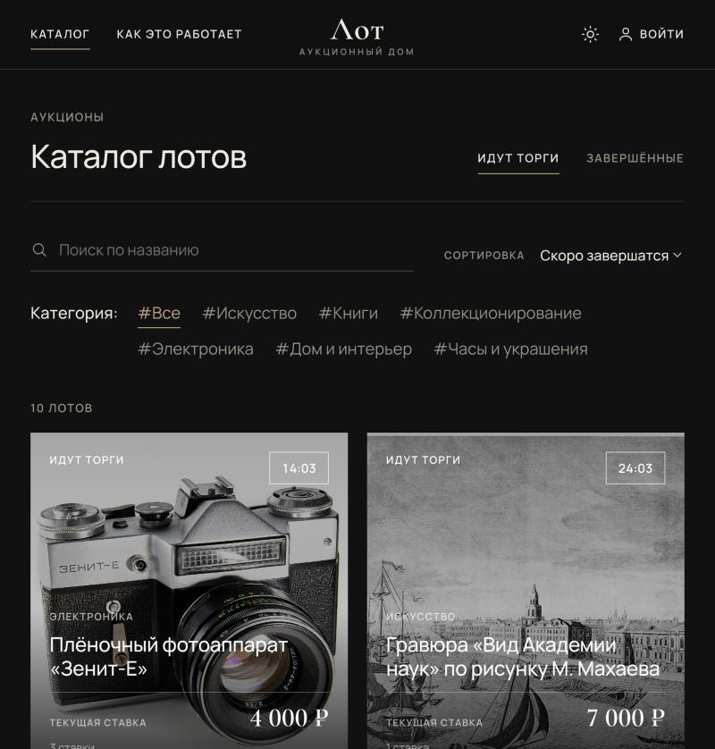 | 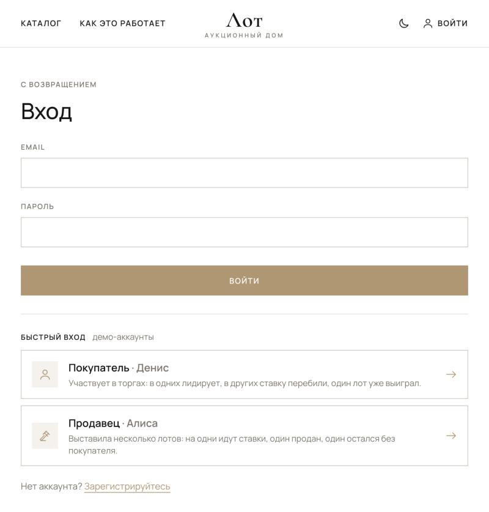 | 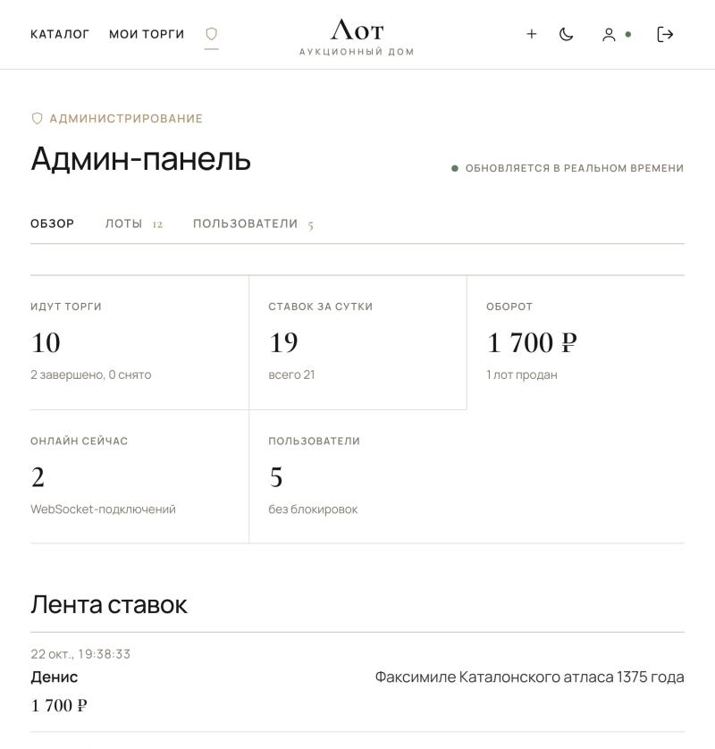 |

| Телефон: главная | Телефон: каталог | Лот снят с торгов |
|---|---|---|
| 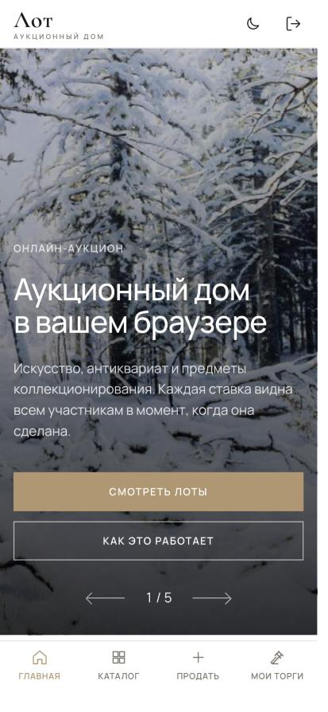 | 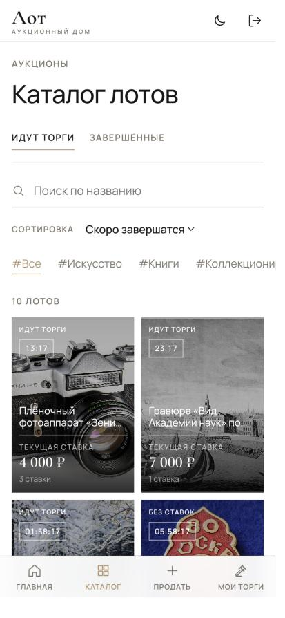 | 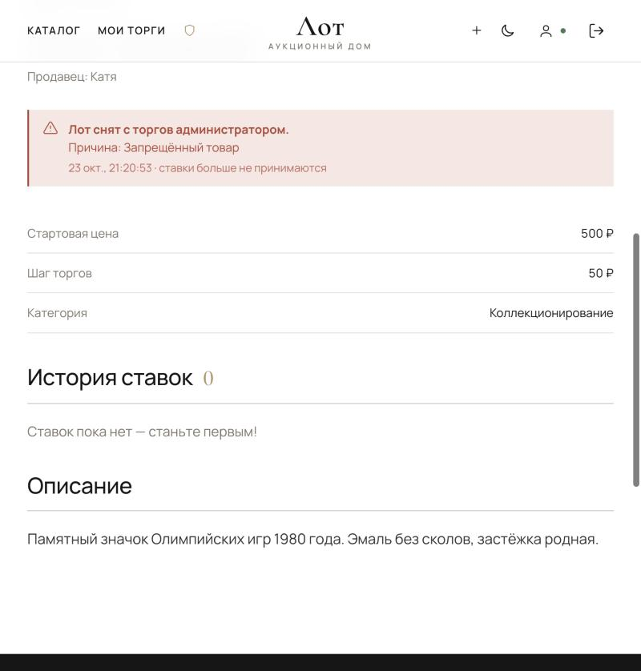 |

---

## Быстрый старт

### Локально

Понадобятся **Go 1.23+**, **Node.js 20+** и **PostgreSQL**.

```bash
createdb lot

cd backend
go run ./cmd/seed -reset    # миграции + демо-данные
go run ./cmd/api            # API и WebSocket на http://localhost:8080
```

Во втором терминале:

```bash
cd frontend
npm install
npm run dev                 # http://localhost:5173
```

Откройте **http://localhost:5173**. Vite проксирует `/api`, `/ws` и `/uploads` на бэкенд, поэтому
фронтенд и API работают с одного адреса — без настройки CORS.

> Демо-лоты длятся от 15 минут до 5 дней. Если торги успели закончиться, просто запустите
> `go run ./cmd/seed -reset` ещё раз.

### Через Docker

```bash
docker compose up --build
docker compose exec api seed -reset
```

Приложение — **http://localhost:8000**, API — http://localhost:8080.

---

## Демо-аккаунты

На странице входа есть блок **«Быстрый вход»** — один клик, без пароля:

| Роль | Пользователь | Что увидите |
|---|---|---|
| **Покупатель** | Денис | В трёх лотах лидирует, в трёх ставку перебили, один выиграл → «Мои торги» |
| **Продавец** | Алиса | Четыре активных лота, один продан, один без покупателя → «Мои лоты» |
| **Администратор** | Ольга | Статистика, лента ставок, модерация лотов и пользователей → «Админ-панель» |

Борис и Катя — фоновые участники торгов. Под любым пользователем можно войти и обычным способом
(`alice@`, `bob@`, `carol@`, `dan@`, `admin@example.test`), пароль — константа `demoPassword`
в [backend/cmd/seed/main.go](backend/cmd/seed/main.go).

> **Быстрый вход нужно выключить в продакшене:** `DEMO_LOGIN=false`.

**Как увидеть работу в реальном времени:** откройте один лот в двух окнах (второе — в режиме инкогнито),
войдите под разными пользователями и сделайте ставку — она сразу появится в обоих окнах,
а у перебитого участника всплывёт уведомление.

---

## Как это устроено

### Архитектура

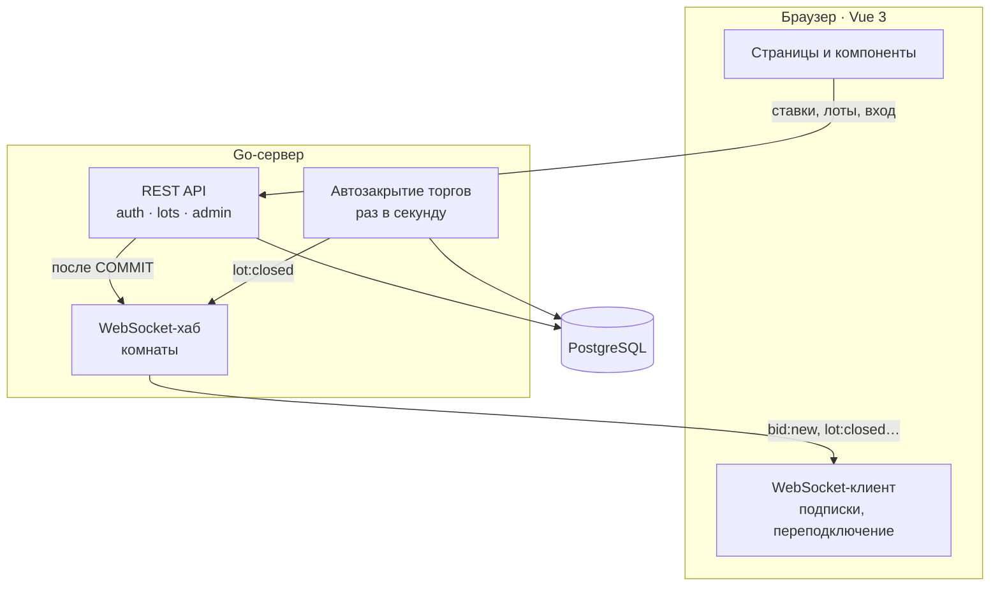

**Ставки отправляются через REST, а WebSocket используется только для рассылки.** Так проще возвращать
понятные ошибки (`bid_too_low`, `auction_closed`…) и проверять права, а WebSocket-сервер остаётся простым:
он не меняет данные, только сообщает о событиях.

### Как проходит ставка

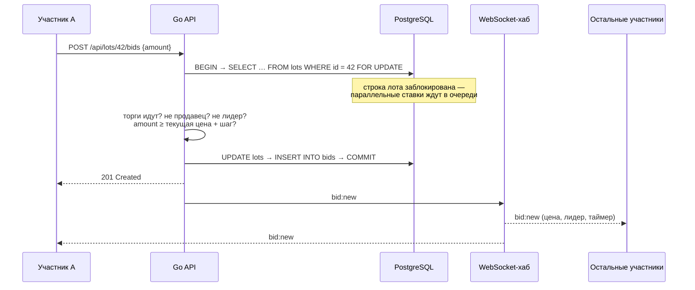

### Одновременные ставки

Главный риск аукциона — двое ставят в одну миллисекунду, и оба считают себя победителями.
Здесь это исключено на уровне базы данных:

- Ставка начинается с `SELECT … FOR UPDATE` — строка лота блокируется до конца транзакции.
  Все ставки на один лот выполняются **строго по очереди**, и каждая следующая проверяется
  относительно цены, уже обновлённой предыдущей.
- Время для проверки «торги ещё идут» берётся **из часов БД после получения блокировки**
  (`clock_timestamp()`), а не из часов приложения — одни часы на всех.
- Ставки на разные лоты не мешают друг другу.
- Событие `bid:new` рассылается только **после `COMMIT`** — участники никогда не увидят ставку, которая откатилась.

Правило ставки: первая ставка — не меньше стартовой цены, каждая следующая — **не меньше текущей + шаг торгов**.
Свою же лидирующую ставку перебить нельзя.

### Автоматическое закрытие торгов

Фоновая горутина раз в секунду выполняет **один SQL-запрос**: находит активные лоты с истёкшим таймером,
переводит их в `finished` и записывает победителя (`winner_id = leader_id`, `final_price = current_price`).
Затем всем рассылается `lot:closed`, победителю — `lot:won`, продавцу — `lot:sold`.

- `FOR UPDATE SKIP LOCKED` пропускает лоты, на которые прямо сейчас идёт ставка, — они закроются на следующем
  тике. Это же позволяет запускать несколько копий сервера без двойного закрытия.
- Ставка, пришедшая после закрытия, видит `status = 'finished'` и получает `auction_closed`.
- Всё состояние — в базе, поэтому перезапуск сервера ничего не теряет.

### Защита от «снайперов»

Если ставка сделана в последние 30 секунд, таймер продлевается до 30 секунд. Побеждает тот, кто готов
заплатить больше, а не тот, кто нажал последним. Значение настраивается (`ANTI_SNIPING_SECONDS`).

### Реальное время на клиенте

- **Одно WebSocket-соединение на вкладку.** Компоненты подписываются на комнаты: `catalog` (все ставки — для
  каталога и главной), `lot:<id>` (страница лота). Персональная комната `user:<id>` назначается сервером
  автоматически — подписаться на чужую нельзя.
- **Переподключение** с экспоненциальной задержкой; после него состояние перезагружается через REST,
  чтобы не потерять события, пришедшие во время обрыва.
- **Медленный клиент не тормозит остальных:** у каждого своя очередь сообщений, при переполнении он отключается.
- **Часы сервера.** Клиент оценивает смещение своих часов по `serverTime` в ответах (`offset = serverTime − (отправка + получение) / 2`)
  и берёт замер с наименьшей задержкой — таймер показывает одинаковое время у всех.
- **Число зрителей** рассылается пакетно раз в 2 секунды, а не на каждый вход/выход — при 1000 подключений это
  одно сообщение на клиента, а не миллион.

### Модерация

- Снятие лота (`status = 'cancelled'`) использует ту же блокировку строки, что и ставка: после снятия
  не пройдёт ни одна ставка. Время снятия фиксируется после получения блокировки, поэтому оно никогда
  не окажется раньше последней принятой ставки.
- Пользователь загружается из БД на каждом защищённом запросе — **блокировка и смена роли действуют сразу**,
  уже выданный JWT перестаёт работать.

### Схема базы данных

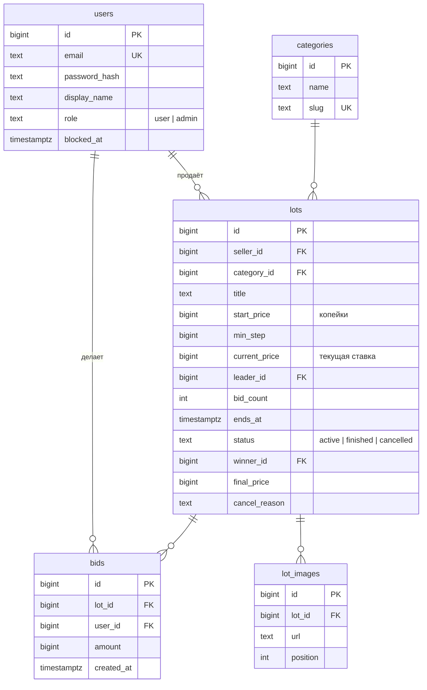

- **Деньги — целые копейки** (`BIGINT`), без `float` и ошибок округления.
- Текущая цена, лидер и число ставок хранятся прямо в `lots` и обновляются в той же транзакции, что и
  вставка ставки, — не нужно каждый раз считать `MAX(bids)`, и данные всегда согласованы.
- Частичный индекс `lots (ends_at) WHERE status = 'active'` делает поиск истёкших лотов дешёвым.
- Миграции встроены в бинарник и применяются при старте: [backend/internal/db/migrations](backend/internal/db/migrations).

---

## API

Все суммы — **в копейках**. Ошибки возвращаются как `{"error": "код", "message": "текст для пользователя"}`.

### REST

| Метод | Путь | Доступ |
|---|---|---|
| `POST` | `/api/auth/register` · `/api/auth/login` · `/api/auth/logout` | |
| `GET` | `/api/auth/me` | 🔒 |
| `GET` `POST` | `/api/auth/demo` — список демо-ролей / вход `{"role": "buyer" \| "seller" \| "admin"}` | при `DEMO_LOGIN=true` |
| `GET` | `/api/categories` | |
| `GET` | `/api/lots?category=&status=active\|finished&q=&sort=ending\|newest\|popular\|price_asc\|price_desc&page=&limit=` | |
| `GET` | `/api/lots/{id}` · `/api/lots/{id}/bids?limit=` | |
| `POST` | `/api/lots` — выставить лот | 🔒 |
| `POST` | `/api/lots/{id}/bids` — `{"amount": 520000}` | 🔒 |
| `POST` | `/api/uploads` — изображение (multipart, поле `file`, до 10 МБ) | 🔒 |
| `GET` | `/api/me/bids` · `/api/me/lots` — «Мои торги» | 🔒 |
| `GET` | `/api/admin/stats` · `/api/admin/bids` · `/api/admin/lots?status=&q=` · `/api/admin/users?q=` | 🛡 |
| `POST` | `/api/admin/lots/{id}/cancel` — `{"reason": "..."}` | 🛡 |
| `POST` | `/api/admin/users/{id}/block` — `{"cancelLots": true}` · `/api/admin/users/{id}/unblock` | 🛡 |

🔒 — нужен вход · 🛡 — только администратор. Заблокированный пользователь получает `403 account_blocked`.

**Ответы на ставку:**

| Код | `error` | Когда |
|---|---|---|
| 201 | — | Ставка принята; в ответе новая цена, лидер, `minNextBid`, `endsAt` |
| 422 | `bid_too_low` | Меньше текущей цены + шаг; в `details.minNextBid` — актуальный минимум |
| 409 | `already_leading` | Ваша ставка и так лидирует |
| 409 | `auction_closed` / `lot_cancelled` | Торги завершены / лот снят |
| 403 | `own_lot` | Ставка на собственный лот |

### WebSocket — `/ws`

Сообщения в JSON: `{"type": "...", "room": "...", "data": {...}}`.

| Направление | Тип | Описание |
|---|---|---|
| → | `subscribe` / `unsubscribe` | Подписка на комнату `catalog` или `lot:<id>` |
| → | `ping` | Ответ `pong` с `serverTime` — для синхронизации часов |
| ← | `welcome` | При подключении: `serverTime`, `userId` (если вошли) |
| ← | `bid:new` | Новая ставка: цена, лидер, число ставок, `minNextBid`, `endsAt`, `extended` |
| ← | `lot:closed` | Торги завершены: победитель и итоговая цена |
| ← | `lot:cancelled` | Лот снят администратором: причина |
| ← | `lot:created` | Новый лот (комната `catalog`) |
| ← | `presence` | Сколько человек смотрит лот |
| ← | `bid:outbid` · `lot:won` · `lot:sold` | Персональные уведомления (комната `user:<id>`) |

---

## Тестирование и нагрузка

### Интеграционные тесты

Проверяют конкурентность на настоящем PostgreSQL, с детектором гонок:

```bash
createdb lot_test
cd backend
TEST_DATABASE_URL=postgres://localhost:5432/lot_test?sslmode=disable go test -race ./...
```

| Сценарий | Что проверяется |
|---|---|
| 100 одинаковых ставок одновременно | Принята ровно одна, остальные — `bid_too_low` |
| 20 участников повышают ставки параллельно | Каждая ставка ≥ предыдущей + шаг, `bid_count` = числу ставок, лидер = автор последней |
| Ставки идут во время автозакрытия | После закрытия нет ни одной ставки, победитель — автор максимальной |
| Администратор снимает лот во время ставок | После снятия не принята ни одна ставка, повторно снять нельзя |

### Нагрузочный тест WebSocket

[backend/cmd/loadtest](backend/cmd/loadtest/main.go) подключает тысячу наблюдателей к одному лоту,
запускает десятки участников, которые ставят без пауз, и в конце сверяет инварианты прямо в базе.
Сервер должен быть запущен:

```bash
cd backend
go run ./cmd/loadtest -watchers 1000 -bidders 50 -duration 15s
```

Результат на MacBook (сервер, база и тест на одной машине):

| Показатель | Значение |
|---|---|
| WebSocket-наблюдателей | 1 000 |
| Участников, ставящих одновременно | 50 |
| Попыток ставок | 25 566 (≈ 1 700 в секунду) |
| Принято ставок | 1 359 — остальные корректно отклонены как устаревшие |
| Ответ на ставку (p50 / p95 / p99) | 30 / 46 / 53 мс |
| Доставка `bid:new` всем наблюдателям (p50 / p95 / p99) | 24 / 36 / 42 мс |
| Доставлено сообщений | **1 359 000 из 1 359 000 (100 %)** |
| `lot:closed` после автозакрытия | 1000 из 1000 |
| Инварианты в БД | все соблюдены |

Альтернативный сценарий для [k6](https://k6.io): `k6 run loadtest/k6/bids.js`.

---

## Настройка

Бэкенд настраивается переменными окружения:

| Переменная | По умолчанию | Назначение |
|---|---|---|
| `ADDR` | `:8080` | Адрес HTTP-сервера |
| `DATABASE_URL` | `postgres://localhost:5432/lot?sslmode=disable` | Подключение к PostgreSQL |
| `JWT_SECRET` | `dev-secret-change-me` | Ключ подписи JWT — **в продакшене обязательно сменить** |
| `COOKIE_SECURE` | `false` | `true` при работе по HTTPS |
| `WS_ALLOWED_ORIGINS` | `localhost:5173,127.0.0.1:5173,localhost:8080` | Разрешённые Origin для WebSocket |
| `UPLOAD_DIR` | `./uploads` | Куда сохраняются загруженные изображения |
| `ANTI_SNIPING_SECONDS` | `30` | Продление торгов при ставке в последние N секунд (`0` — выключено) |
| `CLOSE_INTERVAL_MS` | `1000` | Как часто проверять истёкшие лоты |
| `DEMO_LOGIN` | `true` | Быстрый вход в демо-аккаунты — **в продакшене `false`** |

---

## Структура проекта

```
lot/
├── backend/
│   ├── cmd/
│   │   ├── api/            HTTP + WebSocket сервер
│   │   ├── seed/           демо-данные и демо-аккаунты
│   │   └── loadtest/       нагрузочный тест с проверкой инвариантов
│   └── internal/
│       ├── auth/           регистрация, вход, JWT в httpOnly-cookie, роли, блокировка
│       ├── lots/           каталог, лоты, ставки — валидация и конкурентность
│       ├── closer/         автоматическое закрытие торгов и фиксация победителя
│       ├── realtime/       WebSocket-хаб: комнаты, персональные события, зрители
│       ├── admin/          API админ-панели
│       ├── demo/           описание демо-ролей для быстрого входа
│       ├── uploads/        загрузка изображений
│       ├── db/             подключение и встроенные SQL-миграции
│       ├── config/         настройки из переменных окружения
│       └── httpx/          JSON-ответы и ошибки
├── frontend/src/
│   ├── views/              главная, каталог, лот, вход, «Мои торги», создание лота, админ-панель
│   ├── components/         плитка лота, галерея, таймер, панель ставки, история, уведомления, иконки
│   ├── realtime/           WebSocket-клиент и синхронизация часов
│   ├── api/                REST-клиент и типы
│   ├── stores/             Pinia: авторизация, уведомления
│   ├── composables/        таймер обратного отсчёта, тема
│   └── style.css           дизайн-система: цвета светлой и тёмной темы, типографика
├── loadtest/k6/            сценарий для k6
├── docs/screenshots/       скриншоты для README
└── docker-compose.yml      PostgreSQL + API + фронтенд за nginx
```

**Стек:** Go — [chi](https://github.com/go-chi/chi), [pgx](https://github.com/jackc/pgx),
[coder/websocket](https://github.com/coder/websocket), [golang-jwt](https://github.com/golang-jwt/jwt), bcrypt ·
PostgreSQL 16 · Vue 3 — Vite, TypeScript, Pinia, Vue Router · шрифты Manrope и Cormorant Garamond.

---

## Что можно улучшить

- **Автоставка** — пользователь задаёт максимум, система сама перебивает соперников минимальным шагом.
- **Избранное** и напоминание за 10 минут до конца торгов.
- **Резервная цена** и **«Купить сейчас»**.
- **Отложенный старт** торгов — поле `starts_at` в базе уже есть.
- **Несколько копий сервера** — рассылка событий через Redis Pub/Sub.
- **Ограничение частоты запросов** на вход и ставки.
- Тесты фронтенда (Vitest, Playwright) и CI на GitHub Actions.

---

## Изображения

Фотографии лотов и оформления взяты с [Wikimedia Commons](https://commons.wikimedia.org) и используются
по свободным лицензиям (общественное достояние, CC0, CC BY, CC BY-SA). Файлы не копируются в проект —
страницы загружают их напрямую с серверов Wikimedia, поэтому для картинок нужен интернет.

<details>
<summary>Авторы и лицензии (26 файлов)</summary>


| Файл | Автор | Лицензия |
|---|---|---|
| [2024 Zenit-E (2).jpg](https://commons.wikimedia.org/wiki/File:2024_Zenit-E_(2).jpg) | Jacek Halicki | CC BY-SA 4.0 |
| [2024 Zenit-E (6).jpg](https://commons.wikimedia.org/wiki/File:2024_Zenit-E_(6).jpg) | Jacek Halicki | CC BY-SA 4.0 |
| [80 Москва значок.jpg](https://commons.wikimedia.org/wiki/File:80_%D0%9C%D0%BE%D1%81%D0%BA%D0%B2%D0%B0_%D0%B7%D0%BD%D0%B0%D1%87%D0%BE%D0%BA.jpg) | EgorovaSvetlana | Public domain |
| [Anton Chekhov (Plays, 1912 edition).png](https://commons.wikimedia.org/wiki/File:Anton_Chekhov_(Plays,_1912_edition).png) | Charles Scribner's Sons | Public domain |
| [Chekov works vol 1.jpg](https://commons.wikimedia.org/wiki/File:Chekov_works_vol_1.jpg) | Anton Chekhov | Public domain |
| [Ivan Shishkin - Winter.JPG](https://commons.wikimedia.org/wiki/File:Ivan_Shishkin_-_Winter.JPG) | Ivan Shishkin | Public domain |
| [LFZ chinaware 3.jpg](https://commons.wikimedia.org/wiki/File:LFZ_chinaware_3.jpg) | — | CC BY-SA 3.0 |
| [Lomonosov-porcelain hg 01.jpg](https://commons.wikimedia.org/wiki/File:Lomonosov-porcelain_hg_01.jpg) | Hannes Grobe | CC BY 4.0 |
| [Lomonosov-porcelain hg 04.jpg](https://commons.wikimedia.org/wiki/File:Lomonosov-porcelain_hg_04.jpg) | Hannes Grobe | CC BY 4.0 |
| [Majak 201.jpg](https://commons.wikimedia.org/wiki/File:Majak_201.jpg) | Віктор Ходєєв /Viktor Khodyeyev | Public domain |
| [Poljot Buran chronograph watch from about 1990.jpg](https://commons.wikimedia.org/wiki/File:Poljot_Buran_chronograph_watch_from_about_1990.jpg) | Pittigrilli | CC BY-SA 4.0 |
| [Poljot Buran chronograph watch from about 1990 (detail).jpg](https://commons.wikimedia.org/wiki/File:Poljot_Buran_chronograph_watch_from_about_1990_(detail).jpg) | Pittigrilli | CC BY-SA 4.0 |
| [Zenit-E mit Helios-44-2 -- 2023 -- 0024-31.jpg](https://commons.wikimedia.org/wiki/File:Zenit-E_mit_Helios-44-2_--_2023_--_0024-31.jpg) | Anil Öztas | CC BY-SA 4.0 |
| [10000 roubles Soviet Union, 1921 Front.jpg](https://commons.wikimedia.org/wiki/File:10000_roubles_Soviet_Union,_1921_Front.jpg) | Scanned by Boud, printed by Soviet Union. | Public domain |
| [10000 roubles Soviet Union, 1921 back.jpg](https://commons.wikimedia.org/wiki/File:10000_roubles_Soviet_Union,_1921_back.jpg) | Scanned by Boud, printed by Soviet Union. | Public domain |
| [1375 Atlas Catalan Abraham Cresques.jpg](https://commons.wikimedia.org/wiki/File:1375_Atlas_Catalan_Abraham_Cresques.jpg) | Cresques Abraham | Public domain |
| [Bankers lamp (10806062373).jpg](https://commons.wikimedia.org/wiki/File:Bankers_lamp_(10806062373).jpg) | tlwmdbt from Unna, Germany | CC BY 2.0 |
| [Bankers lamp by Rob Pongsajapan.jpg](https://commons.wikimedia.org/wiki/File:Bankers_lamp_by_Rob_Pongsajapan.jpg) | Rob Pongsajapan | CC BY 2.0 |
| [Forest Landscape with Herons (Shishkin).jpg](https://commons.wikimedia.org/wiki/File:Forest_Landscape_with_Herons_(Shishkin).jpg) | Ivan Shishkin | Public domain |
| [Lenin badges collection.jpg](https://commons.wikimedia.org/wiki/File:Lenin_badges_collection.jpg) | Man vyi | Public domain |
| [Majak203.jpg](https://commons.wikimedia.org/wiki/File:Majak203.jpg) | Віктор Ходєєв /Viktor Khodyeyev | Public domain |
| [Nevskii prospect and Admiralty.jpg](https://commons.wikimedia.org/wiki/File:Nevskii_prospect_and_Admiralty.jpg) | G. A. Kachalov | Public domain |
| [Omega Pocket Watch.jpg](https://commons.wikimedia.org/wiki/File:Omega_Pocket_Watch.jpg) | Mart61 | CC BY-SA 4.0 |
| [SPb Academy of Sciences Kachalov dr Mahaev 1753.jpg](https://commons.wikimedia.org/wiki/File:SPb_Academy_of_Sciences_Kachalov_dr_Mahaev_1753.jpg) | Serge Lachinov (обработка для wiki) | Public domain |
| [Shishkin na severe dikom1.jpg](https://commons.wikimedia.org/wiki/File:Shishkin_na_severe_dikom1.jpg) | Ivan Shishkin | Public domain |
| [Vintage lamp and books (Unsplash).jpg](https://commons.wikimedia.org/wiki/File:Vintage_lamp_and_books_(Unsplash).jpg) | Jez Timms jeztimms | CC0 |

</details>
